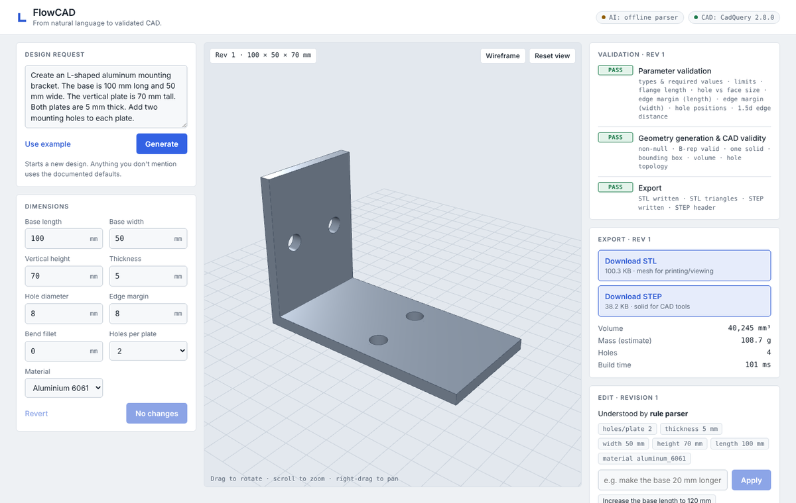
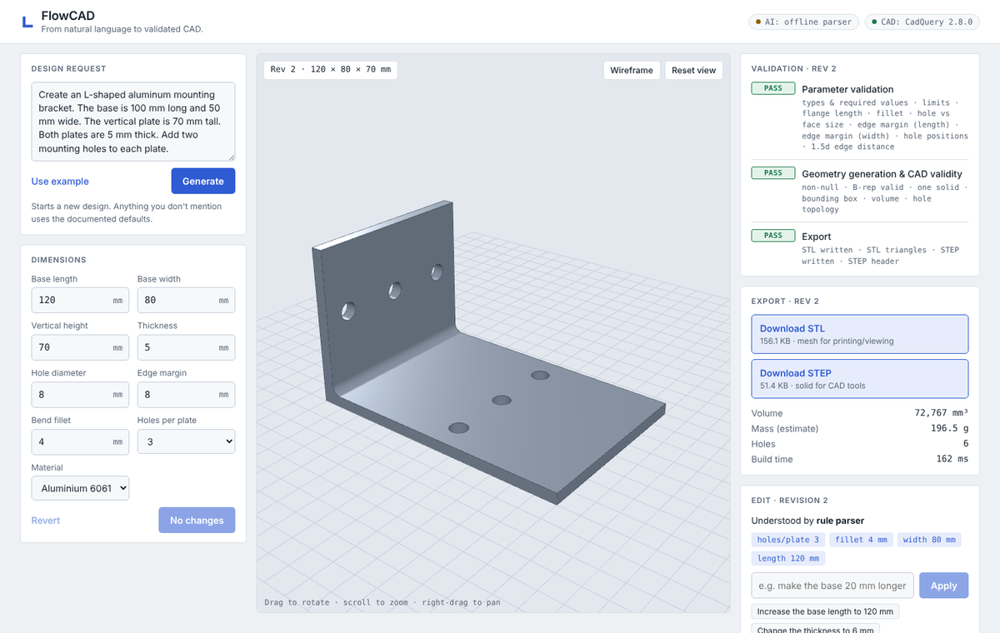
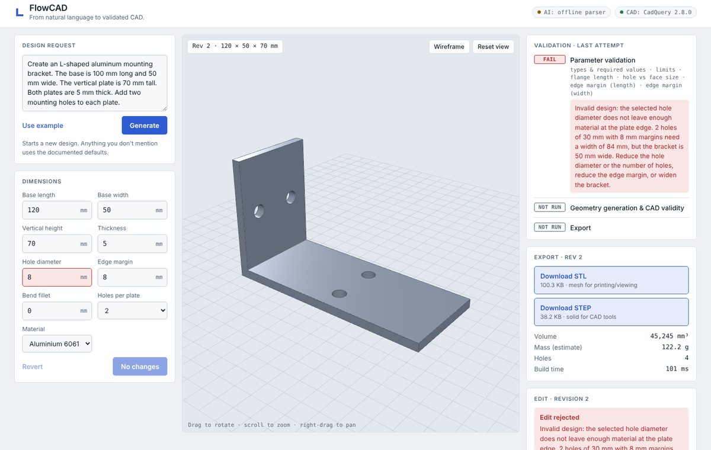

# FlowCAD

**From natural language to validated CAD.**

FlowCAD turns a plain-English request for an L-shaped mounting bracket into a
real, parametric solid model. It checks the model against deterministic
engineering rules, shows it in an interactive 3D viewer, and lets you download
it as STL or STEP. Follow-up requests ("make the holes 10 mm wide") edit the
design; a failed edit never replaces the last valid one.



| Edit applied (rev 2) | Edit rejected, rev 2 preserved |
| --- | --- |
|  |  |

## How it works

```
React + Three.js  ──►  FastAPI  ──►  Gemma 4 (DigitalOcean)  ──►  ProposedChanges (strict schema)
                                 └►  rule parser (fallback)  ─┘            │
                                                                            ▼
            STL/STEP ◄── export checks ◄── geometry checks ◄── CadQuery solid ◄── parameter validator
```

1. **Interpret.** Gemma 4 receives the request and the current parameters and
   must answer with one JSON object: `status` (`ok` / `clarify` /
   `unsupported`), the parameters the user changed, and a message. The reply
   is parsed defensively and validated against a strict Pydantic schema that
   rejects unknown keys. If inference is unavailable, slow, rate-limited or
   returns unusable output, a deterministic rule parser takes over.
2. **Merge.** Changes are applied on top of the current revision, so
   unspecified values are kept.
3. **Validate parameters.** Types, finiteness, limits, flange length, hole vs.
   face size, edge margins along and across each plate, and hole positions.
   Messages are written in engineering language and end with a fix.
4. **Build.** CadQuery (OpenCASCADE) extrudes the L profile as one solid, adds
   an optional inside-bend fillet, and cuts the holes with real booleans. This
   runs in an isolated worker process with a timeout.
5. **Validate geometry.** Non-null, kernel-valid B-rep, exactly one solid,
   bounding box, volume within 0.5 % of the analytic volume, hole topology.
6. **Export and verify.** STL (required) and STEP (optional) are written
   atomically and checked (non-empty, STL triangle count, STEP header) before
   they are offered for download.
7. **Commit.** Only a design that passed every stage becomes a new revision.

The language model never produces code, file paths or CAD operations. It can
only propose values for the nine documented parameters.

## Quick start (local, no cloud needed)

Requirements: Python 3.11+ (tested on 3.13), Node.js 20.19+ (tested on 22).

**Terminal 1, backend** (from the repo root):

```bash
cd backend
python -m venv .venv
source .venv/bin/activate            # Windows PowerShell: .venv\Scripts\Activate.ps1
pip install -r requirements-dev.txt  # CadQuery wheels are large; first install takes a few minutes
uvicorn app.main:app --reload --port 8000
```

**Terminal 2, frontend** (from the repo root):

```bash
cd frontend
npm install
npm run dev
```

Open http://localhost:5173. The Vite dev server proxies `/api` and `/health`
to the backend on port 8000.

Without an API key the header shows **AI: offline parser** and everything
works with the rule parser. To use Gemma 4, copy `.env.example` to `.env` in
the repo root, set `DO_INFERENCE_API_KEY`, then run
`python scripts/check_inference.py` from `backend/` to confirm the model ID
and send one test request.

## Demo script

1. **Use example → Generate.** The spec's example prompt becomes revision 1
   (100 × 50 × 70 mm, 5 mm thick, two Ø8 holes per plate). Point out the
   three validation stages and the checks that ran.
2. Click **Increase the base length to 120 mm** → revision 2. Only the length
   changes.
3. Type **make the base 20 mm longer, 80 mm wide, 3 holes per plate and a
   4 mm bend fillet** → revision 3; the chips show exactly what was understood.
4. Type **Make the holes 30 mm wide** → rejected with the reason, and the
   viewer and downloads stay on the last valid revision.
5. Type **make it bigger** → FlowCAD asks which dimension instead of guessing.
6. Change a value in **Dimensions** and **Apply**.
7. **Download STEP** and open it in FreeCAD or Onshape: it loads as a real
   solid you can measure.

## Supported part and parameters

One part: an L-shaped mounting bracket.

| Parameter | Default | Limits | Meaning |
| --- | --- | --- | --- |
| `base_length_mm` | 100 | 10–500 | Base plate length, from the back face of the vertical plate |
| `base_width_mm` | 50 | 10–500 | Width of both plates |
| `vertical_height_mm` | 70 | 10–500 | Overall height, from the underside of the base |
| `thickness_mm` | 5 | 1–25 | Material thickness of both plates |
| `hole_diameter_mm` | 8 | 1–50 | Every mounting hole |
| `holes_per_plate` | 2 | 0–4 | Holes on each plate, one row across the width |
| `edge_margin_mm` | 8 | 0.5–100 | Minimum material between a hole edge and any plate edge, the bend, or another hole |
| `fillet_radius_mm` | 0 | 0–25 | Inside bend fillet (0 = sharp) |
| `material` | `aluminum_6061` | `aluminum_6061`, `steel_mild`, `stainless_304`, `pla` | Used only for a labelled mass estimate |

**Coordinate system:** origin at the outside corner of the bend; +X along the
base, +Y across the width, +Z up the vertical plate.
**Hole layout:** each plate's row sits midway along its free flange (the flat
part beyond thickness + fillet). One hole is centred across the width; two or
more are spread so the outer holes keep the edge margin. A hole centre closer
to an edge than 1.5 × its diameter is a warning, not an error.

### Example prompts

- `Create an L-shaped aluminum mounting bracket. The base is 100 mm long and 50 mm wide. The vertical plate is 70 mm tall. Both plates are 5 mm thick. Add two mounting holes to each plate.`
- `Make the bracket 120 mm long and increase its thickness to 6 mm.`
- `Make the holes 10 mm wide.` · `Move the holes farther from the edge.` (edge margin +2 mm)
- `Increase the height by 10 mm.` · `Make it 1 mm thicker and 20 mm longer.`
- `Steel bracket for M6 bolts, three holes per plate, 80 mm wide.` (ISO 273 medium clearance: 6.6 mm)
- `0.25 in thick, base 5 in long` (inches and cm are converted to mm)

## API

| Method | Path | Purpose |
| --- | --- | --- |
| GET | `/health` | Service status, CAD engine and version, whether AI is configured |
| GET | `/api/design/default` | Default parameters, limits, materials |
| POST | `/api/design/interpret` | `{text, current_params?}` → proposed parameters, changed fields, parameter validation, or a clarification |
| POST | `/api/design/generate` | `{session_id, params}` → builds a revision from explicit parameters |
| POST | `/api/design/edit` | `{session_id, text}` → interpret, merge with the session's last valid revision, build |
| GET | `/api/files/{name}` | Serves a generated `.stl`/`.step`; `?download=1` for an attachment |

`generate` and `edit` return one shape (`DesignResponse`) with `status`:
`committed` (200), `rejected` (422, `revision` is the preserved last valid
one), `clarify` or `unsupported` (200, nothing built). Interactive docs:
http://localhost:8000/docs.

## Testing

```bash
cd backend
pytest
```

107 tests, all passing at the time of writing. Geometry, API and export
tests build real CadQuery solids; if CadQuery is missing those modules are
reported as **skipped** with the reason, never silently passed. Gemma tests
use a simulated endpoint (`httpx.MockTransport`) and never call DigitalOcean.

Covered: valid default bracket; valid dimension change; zero, negative,
missing, non-finite and non-numeric values; oversized hole; edge-margin
violations along and across each plate; fillet feasibility; real through-holes
(point-in-solid checks); failed edit preserving the last valid design and its
downloads; STL export failure, empty STL, STEP-only failure; malformed,
off-schema and code-injection-shaped model output; HTTP 401/404/429/5xx and
timeouts falling back to the rule parser; health check; path traversal on the
file endpoint; request validation.

Frontend: `cd frontend && npm run build` type-checks and builds. The full UI
flow (generate → edit → rejected edit) was exercised in headless Chrome
against the running backend; there are no automated frontend tests.

## Benchmark

```bash
cd backend
python ../benchmarks/run_benchmark.py --mode rules    # offline parser
python ../benchmarks/run_benchmark.py --mode gemma    # needs DO_INFERENCE_API_KEY
```

18 prompts in `benchmarks/prompts.json`: 12 valid designs, 3 invalid ones that
must be rejected, 2 ambiguous requests and 1 unsupported part. Measured result
for the rule parser (`benchmarks/results/rules.md`):

| Metric | Rule parser |
| --- | --- |
| Parameter extraction correct | 18/18 |
| Geometry generated & valid | 12/12 |
| Export verified | 12/12 |
| Invalid designs rejected | 3/3 |

The rule parser was written alongside these prompts, so this shows the
pipeline works end to end; it is not evidence that the parser generalises to
unseen phrasing. **Gemma 4 has not been benchmarked** (no API key was
available while building); run `--mode gemma` to measure extraction accuracy
and latency.

## Docker

```bash
cp .env.example .env    # optional: add your inference key
docker compose up --build
```

Open http://localhost:8080. nginx serves the frontend and proxies `/api` to
the backend, which is not published on the host. Generated files persist in
the `flowcad-output` volume. Check the CAD kernel inside the container with
`docker compose exec backend python -m app.services.cad_engine`.

**Not verified:** the images were written but could not be built in the
environment where FlowCAD was developed (Docker Hub was unreachable there).
Build and run the check above before relying on them. Compose v2.24+ is
needed for the optional `.env` file.

## Deploying to DigitalOcean

See [docs/DEPLOY_DIGITALOCEAN.md](docs/DEPLOY_DIGITALOCEAN.md): Droplet sizing,
firewall, secrets, build, and the commands that prove the deployed app
actually generates a CAD model. No public deployment exists yet.

## Security

- The inference key is read server-side only; the browser talks only to the
  FlowCAD API (proxied in dev and in Docker).
- Model output is data: strict schema, unknown keys rejected, never executed.
  The CAD code calls a fixed set of trusted functions.
- Every request body is validated; text is capped at 2,000 characters and
  dimensions at the limits above.
- CAD runs in a separate worker process with a 60 s timeout; a crash or hang
  is reported without taking the API down.
- Files are served only if the name matches `<32 hex>.stl|.step` and resolves
  inside the output directory (path traversal is tested).
- An export is reported only after the file exists and passes its checks.

## Known limitations

- One part type (L-bracket) with one hole row per plate. No slots, ribs,
  gussets, countersinks or custom hole positions.
- **CadQuery instead of FreeCAD.** FreeCAD could not be installed headless in
  the time available. CadQuery uses the same OpenCASCADE kernel and exports
  true STEP solids, but there is no native `.FCStd` export. STEP files open in
  FreeCAD.
- Revision history is in memory: it resets on restart and needs a single
  backend worker. Generated files are not cleaned up automatically.
- The mass is an estimate from nominal density, not an engineering
  calculation, and there is no strength or load analysis.
- The Gemma 4 model ID (`gemma-4-31B-it`) comes from the project brief and was
  not confirmed against a live key. DigitalOcean's docs do not document JSON
  mode, so it is off by default and replies are parsed defensively.
- The spec's `cad-engine/` folder was folded into
  `backend/app/services/` because CadQuery runs in the backend's worker
  process; there is no separate CAD service.

## Project structure

```
backend/
  app/
    main.py              FastAPI app, CORS, worker warm-up
    config.py            limits, densities, env settings (.env loader)
    api/routes.py        endpoints, revision commit/reject logic
    schemas/             design, AI and API models (Pydantic)
    services/
      layout.py          coordinate system and hole layout (shared)
      validator.py       deterministic parameter validation
      cad_engine.py      CadQuery build, geometry checks, verified export
      cad_runner.py      isolated worker process with timeout
      gemma.py           Gemma 4 client, system prompt, defensive parsing
      rules.py           offline rule-based parser
      interpreter.py     Gemma → fallback → merge → validate
      store.py           in-memory revisions per session
  scripts/check_inference.py
  tests/                 107 pytest tests
frontend/
  src/App.tsx            state and flows
  src/components/        ModelViewer (Three.js), panels
  src/services/api.ts    typed API client
  nginx.conf, Dockerfile
benchmarks/              prompts, runner, results
docs/                    deployment guide, screenshots
```

## Licenses and attribution

FlowCAD's own code is released under the **MIT License** (`LICENSE`). That
covers FlowCAD's source only; each dependency and the model keep their own
terms.

| Component | License | Notes |
| --- | --- | --- |
| Gemma 4 (Google) | Apache 2.0 | Model weights; accessed as a hosted service, so DigitalOcean's terms of service also apply |
| DigitalOcean Serverless Inference | Commercial service | Paid per token, prepaid balance |
| CadQuery | Apache 2.0 | |
| OCP / OpenCASCADE Technology | LGPL 2.1 with OCCT exception | Used unmodified as a dynamically linked library |
| FastAPI, Pydantic, Starlette | MIT / MIT / BSD-3 | |
| Uvicorn, httpx | BSD-3 | |
| React, Three.js, Vite | MIT | |
| IBM Plex Sans / Mono | SIL Open Font License 1.1 | Loaded from Google Fonts |

Check each project's license file for the authoritative terms before
redistributing binaries or container images.
